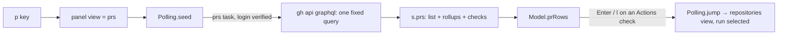

# Spec: A pull-request checks view in the panel

The approved intent's recommendations are the decisions:

1. List open pull requests you authored or are directly asked to review, across
   github.com, in one GraphQL request.
2. Read GraphQL `statusCheckRollup` and track its quota on its own.
3. `p` switches views; caps are 50 pull requests and 50 checks each.
4. Jumping from an Actions check to its run is in scope.
5. The bar widget is unchanged.

**Checked against the live API on 2026-11-23** (one account, 57 matching pull
requests; Codex repeated two of the checks with gh 2.104.0):

- `search(type: ISSUE_ADVANCED)` accepts
  `is:pr is:open archived:false sort:updated-desc (author:@me OR user-review-requested:@me)`.
  Author only gives 47; the `OR` gives 57. This settles the intent reviewers'
  disagreement.
- The full query at 50 pull requests and 50 checks each costs **1 point** and
  returns about 145 KB.
- The reply carries `X-Ratelimit-Resource: graphql` and its own `-Limit`
  (5,000), `-Remaining` and `-Reset` headers.
- A query error comes back as **HTTP 200** with an `errors` array on stdout,
  and `gh api --include` exits 1. A validation error has no top-level `type`.
- `statusCheckRollup` is `null` for a commit with no checks or statuses (10
  of the 57).
- `commits(last: 1)` returned the commit whose `oid` equals `headRefOid` for
  all 57.

## Design

### Data flow



### Helper (`actions.py`)

**`request()`** (line 64) gains an optional `fields` list. Each
`(name, value)` pair becomes `-f name=value` (`--raw-field`, so there is no
`@file` expansion), placed after the endpoint in the argv array. The existing
callers do not change.

**Fixed query.** `PRS_QUERY` is a module constant with `$q` as its only
variable. `PRS_SEARCH` is the constant search string. `@me` resolves on
GitHub's side, so no login, cursor or user text is sent. Quota comes from
the HTTP headers, so the query selects no `rateLimit` and no `updatedAt`.

```graphql
query($q: String!) {
  search(query: $q, type: ISSUE_ADVANCED, first: 50) {
    issueCount
    nodes { ... on PullRequest {
      number title isDraft headRefName headRefOid url
      repository { nameWithOwner }
      commits(last: 1) { nodes { commit { oid statusCheckRollup { state
        contexts(first: 50) { totalCount nodes { __typename
          ... on CheckRun { name status conclusion detailsUrl
            checkSuite { repository { nameWithOwner } workflowRun { databaseId } } }
          ... on StatusContext { context state targetUrl } } } } } } }
    } }
  }
}
```

**`read_prs(task)`** handles the new page kind `prs`. `read_page` (line 191)
calls it before `page_endpoint` when `task["kind"] == "prs"`.

- **Input.** It checks `requestId` as `page_endpoint` does, and refuses any
  key except `kind`, `page` (which must be 1) and `requestId`. `next()` sends
  exactly those keys for `prs`.
- **Result.** Same shape as `read_page`, plus `resource: "graphql"`, which is
  set when the result is created, so it is present on every return,
  including early errors. Only fixed strings and parsed values are returned;
  the raw body and GraphQL `message` text never are.
- **Classification**, in this order:
  1. A transport failure (no stdout: auth or network) or a `FileNotFoundError`
     follows `read_page`'s existing fixed errors.
  2. `http_reply` and `rate_headers` (lines 129 and 170) run unchanged.
  3. HTTP ≥ 400 uses the REST rules (`rate_limited`, 401, 403/404, other),
     with "Pull requests unavailable; token cannot search them" for 403/404.
     The REST branch that copies the raw body into `data` is not reused.
  4. HTTP 200: the body must be JSON. `errors`, when present, must be a list
     of dicts, and each one is classified:
     - `type == "RATE_LIMITED"` → **rate**;
     - `type` `FORBIDDEN`, or `SAML` in `type` or `message` → **access**;
     - anything else → **other**.

     A node error has a `path` that starts with `["search", "nodes", i]`,
     where `i` is an int.
  5. **Usable data** means `data.search` is a dict with a list `nodes`.
     - Without usable data, the first error decides:
       - rate → `rate`;
       - access → `permission`, "Pull requests unavailable; token or SSO
         refused";
       - otherwise `network`, "GitHub returned an error for pull requests".
     - With usable data, the reply is kept whatever `gh`'s exit code:
       - node errors mark only their pull request `unavailable`;
       - any rate error, node or not, also sets `errorType: "rate"` with
         `data` kept, so the shared cooldown applies;
       - pathless (non-rate) errors set `partial: true`.
- **Parsing.** `pull_request(node, i, failed)` keeps plain fields only. `i` is
  the node's original `enumerate` index, taken before any node is skipped.
  - Nodes are skipped when they are not dicts, have no int `number` ≥ 1, or
    have a `repository.nameWithOwner` that `repo_name` refuses.
  - Each pull request becomes `{repo, number, title, branch, draft, url,
    sha, checks}`:
    - `title` is `plain()` cut to 200 characters; `branch` is `plain()` cut
      to 100; `draft` is `isDraft is True`.
    - `url` is kept only if it equals
      `https://github.com/<repo>/pull/<number>`; otherwise it is `""`.
    - `sha` is `headRefOid` if it is 40 hex characters.
  - `checks` is one of:
    - `{state: "unavailable"}` when the node has an error path, `sha` is
      missing, or the last commit's `oid` is not `sha` (a force-push between
      the two reads);
    - `{state: "none"}` only when the matching commit's `statusCheckRollup`
      key is present and `null`;
    - `{state, total, items}` otherwise:
      - `state`: `SUCCESS` → `success`, `FAILURE`/`ERROR` → `failure`,
        `PENDING`/`EXPECTED` → `pending`, and anything else (including a
        malformed rollup) → `unavailable`;
      - `total`: `contexts.totalCount` if it is an int ≥ 0, else the number
        of items.
  - **Items.** Each one is `{name, status, conclusion, url, repo, run}`, and
    every value is checked against a fixed set:
    - **CheckRun:**
      - `name`: a string, `plain()`, cut to 100;
      - `status`: one of `queued in_progress completed waiting pending
        requested`, else `unknown`;
      - `conclusion`: one of `success failure neutral cancelled timed_out
        action_required skipped stale startup_failure`, else `""`;
      - `url`: `detailsUrl`;
      - `repo`: the check suite's `nameWithOwner` if `repo_name` accepts it,
        else `""`;
      - `run`: `workflowRun.databaseId` as a string if it is an int ≥ 1,
        else `""`.
    - **StatusContext:**
      - `name`: `context`, as a string, `plain()`, cut to 100;
      - status and conclusion by `state`:
        - `SUCCESS` → `completed`/`success`;
        - `FAILURE` or `ERROR` → `completed`/`failure`;
        - `PENDING` or `EXPECTED` → `pending`/`""`;
        - anything else → `unknown`/`""`;
      - `url`: `targetUrl`;
      - `repo` and `run`: `""`.
    - **Other node types** are skipped. They still count in `total`, so the
      "more" row shows.
  - **Links** (the pull request's and each item's): a string is kept as-is
    only when `plain()` would not change it, else `""`. The panel decides
    what can be opened; see the model section.
- **Data:** `{list, total: issueCount, partial}`, with at most 50 entries.
  `total` is `issueCount` if it is an int ≥ 0, else the length of the list.

`main()` (line 468) needs no change: `prs` uses the `page` mode.

### Scheduler (`Polling.js`)

**State in `create()`:**

- `prView:false`;
- `prs:{list:null, total:0, at:undefined, error:"", partial:false}`;
- `gqlRemaining:null`, `gqlResetAt:0`.

**Timing.** `TIMING` gains `prs:60000` and `prsActive:15000`.

**Tasks.** There is one task, `prs::`: kind `prs`, no repo, group
`interactive`.

- **`view(s, on, now)`** sets `prView` and clears `wakeAt`. When `on` is
  false and the `prs` task is not in flight, it deletes the task.
- **`seed`** (line 124), only while `opened && prView && accountVerified`:
  - `due = age(prs.at, interval × gqlPace(s, now))`, where the interval is
    `prsActive` when any listed pull request is `pending`, and `prs`
    otherwise.
  - The task is created only `if (now >= due)`, the way `summary` and `jobs`
    are, so a quota reset or a change of interval takes effect at once
    without a stale deadline.
  - A second clause deletes a queued `prs` task while the view is off, or
    while the login is not verified.
  - The existing deletion loop (lines 126-134) leaves `prs::` alone, since it
    has no repository owner. The one-second reseed in `next()` (line 175)
    picks up the deadline, so no new wake term is needed.
  - **Fairness.** `prs` runs at most every 15 s in an interactive slot (one
    in five slots stays background or active, line 197). In the PR view,
    `select(s,"","")` removes the selected repository's interactive work.
- **`next()`** sends `{kind:"prs", page:1, requestId}` for `prs`, without
  `repo` or `run`.
- **Quota kept apart:**
  - `completeReply` (line 320) writes `gqlRemaining`/`gqlResetAt` when
    `reply.resource==="graphql"`, and otherwise `remaining`/`resetAt` as
    now. That is the only place either pair is written, and `noteWrite`
    calls `cool()` only.
  - `gqlPace(s, now)` is `pace()` over the GraphQL pair. `pace()` stays
    REST-only.
  - `cool()` is unchanged. A rate limit or zero remaining on either API sets
    the one shared cooldown, which pauses everything as today; the bar shows
    the pause.
- **`completeReply` for `prs`.** It is handled before the shared error block,
  so pull-request errors never set `s.error` and never show in the
  repositories view.
  - "Invalid data" requires an object with `Array.isArray(data.list)`.
  - When `data` is usable, which includes a rate reply that still has rows:
    1. store `list`, `total`, `partial` and `at=now`;
    2. set `error` to "Some checks could not be read" when `partial`, else
       `""`;
    3. run `cool()`;
    4. delete the task. `seed` creates the next one when it is due.
  - Errors without data:
    - `prs.error = reply.error`;
    - `auth` and `setup` set `s.auth` as today, which stops all reads until
      `r`;
    - `rate` and `network` keep the task with the existing backoff and
      cooldown;
    - `permission` sets `prs.at=now` and deletes the task, so it retries on
      the interval or on `r`.

    No error marks a repository blocked. Cached rows stay, and the PR
    view's status strip shows `prs.error`.
- **Account:**
  - On a login change, the reset block (line 376) also resets `prs` to its
    initial state and sets `gqlRemaining=null`, `gqlResetAt=0`. It keeps
    `prView`.
  - On an account `permission` reply (line 336), `prs` is also reset: an
    unverified identity must not keep or fill a list that GitHub resolves
    from `@me`.
  - The account task runs first after every `open()`, because `next()`
    holds other kinds until `accountChecked`.
  - `close()` bumps the generation, so a `prs` reply started under the old
    account is dropped by `complete()`.
- **`manual`** (line 71), in the PR view: it checks the account as today,
  makes `prs` due now (`restart` when it is queued, `ensure` otherwise) and
  returns. `Shift+R` in the PR view does the same, without rediscovering
  repositories.
- **`jump(s, repo, run, expanded, now)`**:
  1. `view(s,false,now)`;
  2. `select(s, repo, run, expanded, now, true)`;
  3. `touch(s, repo, run, now)` (line 109).

  Reviewers confirmed that this fetches an uncached run and that `kept()`
  (line 240) retains it through expansion and inspection.
- **Panel closed.** `close()` (line 43) already drops every task. Nothing is
  fetched for pull requests while the panel is closed, and watches are
  unchanged.

### Model (`ActionsModel.js`)

- **`prRows(prs, expanded, filter, now)`** builds:
  - **One `kind:"pr"` row per pull request:**
    - key `pr:<repo>#<number>`;
    - title `<repo> #<number> <title>`, with `Draft · ` in front for a
      draft;
    - subtitle: the branch;
    - status:
      - `success` → `success`;
      - `failure` → `failure`;
      - `pending` → `in_progress`;
      - `none` → `""`, with statusText "no checks";
      - `unavailable` → `error`, with statusText "checks unavailable";
    - statusText otherwise via `label()`;
    - `info`: `N checks`, plus "checked 40s ago" or "checked 3m ago" when
      `now - prs.at` exceeds the refresh interval. Seconds are used below a
      minute;
    - `url`: the pull request's link only if `browsable`.
  - **When expanded, one `kind:"check"` row per item:**
    - key `<pr key>:<index>:<name>`;
    - title: the name;
    - status `state(item)`, statusText `label(state(item))`, `info:""`, so
      the delegate does not repeat the text;
    - `url` only if `browsable(item.url)`, and `external: true` when there
      is a link that is not on github.com;
    - `repo` and `run` from the item.
  - **"More" rows** (`kind:"more"`):
    - after the checks, when `total > items.length`: "N more checks on
      GitHub", url `<pr url>/checks` (`""` without a pull-request link);
    - at the end, when `prs.total > list.length`: "N more on GitHub", url
      `https://github.com/pulls`.
  - **Filter.** It matches repository, title, branch and status text for a
    pull request, and name and status for a check. A pull request with a
    matching check is shown with that check, as runs are shown under
    repositories.
- **`emptyText`** for the PR view (its own function, `prEmptyText(state)`):
  - "Verifying your GitHub login…" before `accountChecked`;
  - "Pull requests need a verified GitHub login; check gh auth status" when
    `accountChecked && !accountVerified`;
  - "Loading pull requests…" while `list` is `null`;
  - `prs.error` when the list is `null` and there is an error;
  - "No open pull requests";
  - `No match for "x"`.
- **`prStatusLine(s, now)`** builds the PR view's status strip, with:
  - the notice;
  - `prs.error`;
  - the shared cooldown ("GitHub paused until …");
  - "N open pull requests";
  - quota `quotaText(gqlRemaining, gqlResetAt, now, "GraphQL points")`.

  `quotaText` (line 156) gains an optional label, defaulting to "API
  requests".
- **`accessibleName`** (line 187) handles `pr` ("pull request: …,
  expanded/collapsed") and `check`.

### Panel (`ActionsPanel.qml`)

**View state:**

- `property string view: "repos"`. `close()` and `open()` don't reset it,
  so the panel reopens in the view it was closed in, until the shell
  restarts.
- `viewState` keeps `{filter, key}` per view.
- **`switchView(target, filter, key)`** is the one switch path:
  1. Save the current view's filter and selected key.
  2. Set `detail=false`.
  3. Set `switching=true`, then inside `try/finally`:
     - set `view` and call `Polling.view`;
     - assign the filter;
     - set `switching=false`.

     `onFilterTextChanged` (line 91) returns early while `switching` is set.
  4. Call `rebuild(false, key)`.

  It does not pump. `p` calls `switchView`, then `selectionChanged(true)`
  and `pump()`; the jump calls it with its own key, as below.
- **`rebuild(resetSelection, selectKey)`** (line 149):
  - When `selectKey` is given, it selects that key (or the first row when it
    is absent), skips the scroll-anchor branch (lines 163-173) and calls
    `positionViewAtIndex(cursor, ListView.Contain)`.
  - In the PR view, it builds `Model.prRows`, passing `null` for the list
    until `polling.accountVerified`.
- `expanded` is shared; the two views use disjoint key prefixes, so each
  keeps its own expansion.
- **`selectionChanged`** (line 240) calls `Polling.select(polling, "", "",
  expanded, …)` in the PR view.

**Keys:**

- **`p`** switches views. It is handled in the list key handler (line 565),
  after the action confirmation, and auto-repeat is ignored (line 580). In
  the search field, `p` is text.
- **Shared handlers.** `enter()`, `expand()`, the chevron and the bold title
  (lines 198, 208 and 727) treat `pr` like `repo`. Search Return goes
  through `expand()`, so it works the same way.
- **On a `check` row**, Enter, Space, → and `l` jump. The `expand()` and
  `enter()` paths both route `check` to `jump()`.
- ← and `h` collapse, or select the parent row, as today.
- **`o` and `y`**:
  - on a row with a github.com link, they open or copy it;
  - on a check marked `external`: "Link is not on github.com; o on the pull
    request opens it";
  - on a check without a link: "No link".

  `copyLink()` keeps refusing `more` rows ("Nothing to copy"), as today; `o`
  opens them.
- **`r` and `Shift+R`** refresh the list.
- **`v w a f c m i`** say "Not available on pull requests". Navigation, `/`,
  `?`, Esc and zoom are unchanged.

**Jump**, from a `check` row:

- It needs `run` set, a `repo` that `Polling.repoFor` finds, and that
  repository not archived, disabled or blocked. Otherwise the footer says
  one of:
  - "Not an Actions check" (plus "; o opens it" only when the check has a
    github.com link);
  - "Repository not in your list";
  - "Repository is archived, disabled or unavailable".
- Order, so that nothing pumps or reselects in between:
  1. Add `repo:<repo>` and `<repo>:<run>` to `expanded`.
  2. Call `Polling.jump(polling, repo, run, expanded, now)`.
  3. Set `jumpKey="<repo>:<run>"`.
  4. Call `switchView("repos", "", jumpKey)`.
  5. Call `adopt()`, then `pump()`.
- **While `jumpKey` is set:**
  - `adopt()` skips its trailing `selectionChanged(false)`, so the
    scheduler keeps the jumped run selected;
  - `rebuild()` uses `jumpKey` as its `selectKey`.

  When the row exists, `jumpKey` is cleared and `selectionChanged(true)`
  runs.
- **`jumpKey` is also cleared** on cursor movement, `p`, close, an account
  change, or when the run's lookup fails. A failed lookup is a
  `lookupError`, or the `run` task gone with no row; the footer then says
  "Run unavailable".

**Account change.** `adopt()` compares `polling.account` with the last
adopted login. On a change, it resets both `viewState` entries, the live
filter (inside `switching`), `jumpKey` and `detail`, and keeps `view`.

**Chrome by view:**

- the header (`titleText`, line 88): `Pull requests · N open · <login>`;
- the status strip (line 74): `Model.prStatusLine` in the PR view;
- the search placeholder and accessible name (lines 631, 650):
  "Search pull requests…";
- the coverage note (line 660): hidden in the PR view;
- the footer hint (line 809): includes `p`, with a short PR-view hint;
- the detail pane: hidden in the PR view.

**Test hook.** `status()` adds `view`, `prs` (the count, or -1 while `null`)
and `jumpKey`.

### Docs

- **README:**
  - the keys table: `p`, Enter and `l` on a check, and `r`/`Shift+R` in the
    PR view;
  - a "Pull requests" section:
    - what is listed: authored pull requests and direct review requests,
      not team requests;
    - the 50/50 caps;
    - the check states;
    - the jump rules;
    - external status links;
    - the verified login it needs;
    - token permissions: gh's default OAuth token (`repo` scope) covers it.
      A fine-grained token needs Pull requests, Checks and Commit statuses
      read; without them, or with SSO not authorised, rows show "checks
      unavailable";
  - the refresh table: the list every 60 s, or 15 s while checks are
    running, best effort, and on `r`;
  - GraphQL points in the rate-limit text.
- **`keybindings.sh`:** `p`, Enter/`l` on a check, and the PR-view meanings
  of the expand, search, `r` and `Shift+R` lines.
- **`manifest.json`:** 1.3.0.

## Alternatives rejected

- **REST** (search, then the pull request, check runs and combined status
  per pull request): about 151 requests per refresh against 1 point, and
  four request kinds.
- **Every open pull request of each catalogue repository (intent 1c)**: at
  least one request per repository per refresh, competing with run polling.
- **Two aliased searches** instead of `OR`: `OR` works, and one search keeps
  one order and one total.
- **Matching cached runs by commit**: misses every non-Actions check and
  every run past the cache.
- **`review-requested:@me`**, which includes team requests: can list many
  pull requests from large organisations. Direct requests match the intent.
- **Paging past 50**: "N more on GitHub" links the full list.
- **A tree under each check** (jobs, steps): the jump reuses the existing run
  rows, logs, watches and actions.
- **Showing pull requests for an unverified login** (agy's suggestion): the
  list is resolved from `@me`, so an unverified login could put one
  account's pull requests in another's cache (Codex's finding). A token that
  cannot read `/user` gets a clear message instead.

## Risks

- **Search index lag:** a pull request opened or closed seconds ago can be
  missing or still listed until the next refresh. The check state is current
  at query time.
- **Reply size:** about 145 KB at the caps, read through the existing
  `StdioCollector` path. The smoke test already replies with about 200 KiB
  in 4 KiB chunks.
- **Partial replies.** SSO and fine-grained tokens mark only the affected
  pull requests "checks unavailable". A pathless error keeps the rows and
  says "Some checks could not be read". A rollup that GitHub withholds as
  `null` without an error would show "no checks"; this could not be
  verified without such a token.
- **Rows:** 50 × 50, all expanded, is 2,550 rows, above the 1,650 that
  `tests/bench-rows.cjs` measures (about 7 ms). The bench gains a PR case.
- **The jump to an older run:** `touch` fetches it, and `kept()` keeps it
  while it is selected and expanded. A gone or forbidden run says "Run
  unavailable".
- **Panel size:** `ActionsPanel.qml` is 824 lines. Row building stays in the
  model and scheduling in `Polling.js`, where both are unit-tested.
- **Hosts:** p620 and razer on the 1.3.0 deploy; p510 untouched.

## Verification

- **`python3 -m unittest discover -s tests`** (fixtures are literal
  `--include` stdout with exit codes):
  - the argv has the fixed query and `q` as `-f` fields;
  - extra keys and page 2 are refused;
  - `resource` is present on every return, including 403 and a missing `gh`;
  - parsing:
    - plain text and cuts for the title, branch, check name and status
      context;
    - draft;
    - PR URL pinning, with a foreign URL → `""`;
    - a link that `plain()` would change → `""`;
    - `none`, and `unavailable` by error path (with the index taken after a
      skipped `nodes[0]`), by a missing sha and by an oid mismatch;
    - the rollup and both item enum sets, with unknown and non-string
      values;
    - other node types counted but skipped;
    - a bad repository name skipped;
  - classification:
    - HTTP 200 with exit 1:
      - `RATE_LIMITED` and no data → `rate`;
      - `FORBIDDEN` → `permission`;
      - a validation error → `network`;
    - with usable data:
      - a node error → that row `unavailable`, rest kept;
      - a pathless error → `partial`;
      - a rate error → `rate` with the data kept;
    - malformed `errors` and malformed nested data → `network`;
    - no `message` text in any result.
- **`node tests/polling.cjs`**:
  - nothing is scheduled while the view is off, the panel is closed, or the
    login is unverified;
  - when the view turns on, the list is due at once, then every 60 s, or
    15 s with a pending pull request;
  - a quota reset pulls the next deadline in;
  - a successful task is deleted and re-seeded only when due;
  - `manual` and `Shift+R` in the view refresh the list only;
  - GraphQL quota updates `gqlRemaining` and leaves `remaining` unchanged,
    and the reverse;
  - `gqlPace` slows only `prs`;
  - a rate reply with rows stores the rows and sets the cooldown;
  - `prs` errors set `prs.error`, never `s.error`, and never block a
    repository;
  - a login change and an account `permission` reply both reset `prs`;
  - a login change also resets the GraphQL quota;
  - a reply from an old generation is ignored;
  - turning the view off deletes a queued `prs` task;
  - `jump` keeps a run older than the ten newest finished runs and starts
    its `run` task;
  - in the view, the selected repository's summary is not scheduled;
  - under sustained active and background load, `prs` still starts within
    its interval.
- **`node tests/model.cjs`**:
  - `prRows` titles, draft mark, and each state's status and text;
  - age text in seconds and minutes;
  - check rows (no repeated text, `external` flag), and both "more" rows
    with their URLs;
  - the filter on title, branch, status and check name;
  - each `prEmptyText` state;
  - `prStatusLine` with `prs.error`, the cooldown and the GraphQL label;
  - accessible names.
- **`node tests/bench-rows.cjs`**: 2,550 PR rows within the existing budget.
- **QML smoke**, only in CI or a headless VM, never on the desktop. The fake
  helper gains `kind:"prs"` (before its repository branch), with `resource`
  and quota. One check points to run 9001, which is in no list reply and
  only answers `kind:"run"`.
  - `p` switches. Moving the cursor, setting a filter, then `p` there and
    back restores both views' cursor by key, and their filters.
  - `p` typed while filtering is text; `p` during an action confirmation
    does not switch; `p` with run details open hides them.
  - The header, the status strip shows GraphQL points, and
    `status().view`/`prs`.
  - Enter on the check of run 9001: the fake logs a `run` request for 9001;
    then the row `<repo>:9001` is selected and visible, and `jumpKey` is
    cleared.
  - A second jump whose `run` lookup is refused: the footer says "Run
    unavailable" and `jumpKey` is cleared.
  - Enter on a non-Actions check shows the footer message. `o` on an
    external check shows the github.com notice. `v` on a PR row shows "Not
    available on pull requests".
  - Closing and reopening keeps the view; before the account check,
    `status().prs` is -1.
  - An account change (the fake answers `user` with another login on
    reopen): PR rows, filters and `jumpKey` are cleared, and the view is
    kept.
- **Manual on p620 after deploy:** open the panel, press `p`, expand a real
  pull request and jump into one Actions check.
