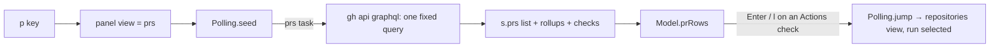

# Spec: A pull-request checks view in the panel

The approved intent's recommendations are the decisions:

1. List open pull requests you authored or are directly asked to review, across
   github.com, in one GraphQL request.
2. Read GraphQL `statusCheckRollup` and track its quota on its own.
3. `p` switches views; caps are 50 pull requests and 50 checks each.
4. Jumping from an Actions check to its run is in scope.
5. The bar widget is unchanged.

**Checked against the live API on 2026-11-23** (one account, 57 matching pull
requests):

- `search(type: ISSUE_ADVANCED)` accepts
  `is:pr is:open archived:false sort:updated-desc (author:@me OR user-review-requested:@me)`.
  Author only gives 47; the `OR` gives 57. This settles the disagreement
  between the intent reviewers.
- The full query below, at 50 pull requests and 50 checks each, costs **1
  point** and returns about 145 KB.
- The reply carries `X-Ratelimit-Resource: graphql` and its own `-Limit`
  (5,000), `-Remaining` and `-Reset` headers.
- A query error comes back as **HTTP 200** with an `errors` array, and
  `gh api` exits 1.
- `statusCheckRollup` is `null` for a commit with no checks or statuses (10
  of the 57).
- `commits(last: 1)` returned the commit whose `oid` equals `headRefOid` for
  all 57.

## Design

### Data flow



### Helper (`actions.py`)

**`request()`** (line 64) gains an optional `fields` list. Each
`(name, value)` pair becomes `-f name=value`, placed after the endpoint, so
GraphQL variables never enter the query text. The existing callers do not
change.

**The fixed query** is a module constant `PRS_QUERY`, with `$q` as its only
variable. `PRS_SEARCH` is the constant search string
`is:pr is:open archived:false sort:updated-desc (author:@me OR user-review-requested:@me)`.
`@me` resolves on GitHub's side, so no login, cursor or user text is sent.

```graphql
query($q: String!) {
  search(query: $q, type: ISSUE_ADVANCED, first: 50) {
    issueCount
    nodes { ... on PullRequest {
      number title isDraft headRefName headRefOid url updatedAt
      repository { nameWithOwner }
      commits(last: 1) { nodes { commit { oid statusCheckRollup { state
        contexts(first: 50) { totalCount nodes { __typename
          ... on CheckRun { name status conclusion detailsUrl
            checkSuite { repository { nameWithOwner } workflowRun { databaseId } } }
          ... on StatusContext { context state targetUrl } } } } } } }
    } }
  }
  rateLimit { cost remaining resetAt }
}
```

**`read_prs(task)`** handles the new page kind `prs`. `read_page` (line 191)
calls it before `page_endpoint` when `task["kind"] == "prs"`.

- **Input.** It checks `requestId` as `page_endpoint` does and refuses any
  other key except `kind`, `page` (which must be 1) and `requestId`.
- **Request.** It calls `request("graphql", include=True, fields=[("query",
  PRS_QUERY), ("q", PRS_SEARCH)])`.
- **Headers and quota.**
  - It reads the HTTP status and headers with `http_reply` and
    `rate_headers` (lines 129 and 170), unchanged.
  - It adds `result["resource"] = "graphql"`. `rate_headers` leaves the
    resource out, and the REST paths don't send one, so the field is set
    only here.
- **Classification:**
  - Under the same rules as REST (HTTP ≥ 400, `rate_limited`, 401, 403/404),
    the 403/404 text is "Pull requests unavailable; token cannot search them".
  - An HTTP 200 reply with `errors` and no usable `data.search` is
    classified as follows:
    - any error `type` of `RATE_LIMITED` → `rate`;
    - `FORBIDDEN` or `SAML` (in the type or message) → `permission`,
      "Pull requests unavailable; token or SSO refused";
    - anything else → `network`, "GitHub returned an error for pull
      requests".
  - A non-zero `gh` exit with an HTTP 200 body that has `data.search` and
    `errors` is a **partial reply**. It is kept.
  - The text of an error `message` never reaches the panel, because it can
    quote a query or a repository name.
- **Parsing** (`pull_request(node, failed)`), into plain fields only:
  - Nodes that are not dicts are skipped. So are nodes without an int
    `number` ≥ 1 or a valid `repo_name(repository.nameWithOwner)`.
  - Each pull request becomes `{repo, number, title, branch, draft, url,
    updated, sha, checks}`:
    - `title` is `plain()` cut to 200, `branch` is `plain()` cut to 100, and
      `draft` is a bool.
    - `url` is kept only if it equals
      `https://github.com/<repo>/pull/<number>`; otherwise it is `""`.
    - `sha` is `headRefOid`, kept only if it is 40 hex characters.
  - `checks` is one of:
    - `{state: "unavailable"}` when any error `path` starts with
      `["search", "nodes", i]` for this node, or when the last commit's
      `oid` is not `sha` (a force-push between the two reads);
    - `{state: "none"}` when `statusCheckRollup` is `null`;
    - `{state: rollup, total, items}`, where `rollup` maps `SUCCESS` →
      `success`, `FAILURE`/`ERROR` → `failure` and `PENDING`/`EXPECTED` →
      `pending`. Any other value becomes `unavailable`.
  - Each item is `{name, status, conclusion, url, repo, run}`:
    - **CheckRun:**
      - `name` is the `plain()` name cut to 100;
      - `status` is lower-cased from `QUEUED`, `IN_PROGRESS`, `COMPLETED`,
        `WAITING`, `PENDING` or `REQUESTED`, and any other value is
        `unknown`;
      - `conclusion` is lower-cased, or `""` when it is `null`;
      - `url` is `detailsUrl`;
      - `repo` is the check suite's `nameWithOwner` if `repo_name` accepts
        it, otherwise `""`;
      - `run` is the workflow run's `databaseId` as a string if it is an int
        ≥ 1, otherwise `""` (a non-Actions app).
    - **StatusContext:**
      - `name` is `context`;
      - `SUCCESS` → `completed`/`success`, `FAILURE` and `ERROR` →
        `completed`/`failure`, and `PENDING`/`EXPECTED` → `pending`/`""`;
      - `url` is `targetUrl`;
      - `repo` and `run` are `""`.
  - `total` is `contexts.totalCount` when it is an int ≥ 0.
  - Each `url` goes through `plain()`. The panel decides which links can be
    opened; see the model section.
- **Result.** `data = {list: [...], total: issueCount}`, where the list
  never holds more than 50 entries. If `data.search` is missing or not a
  dict, the reply is "invalid data" (`network`), as today.

`main()` (line 468) needs no change: `prs` uses the `page` mode.

### Scheduler (`Polling.js`)

**State in `create()`:**

- `prView:false`;
- `prs:{list:null, total:0, at:undefined, error:""}`;
- `gqlRemaining:null`, `gqlResetAt:0`.

**Timing.** `TIMING` gains `prs:60000` and `prsActive:15000`.

**Task identity.** There is one task, `prs::` (kind `prs`, no repo, group
`interactive`).

- **`view(s, on, now)`** sets `prView` and clears `wakeAt`. When `on` is
  false and the `prs` task is not in flight, it deletes the task.
- **`seed`** (line 124):
  - Only while `opened && prView`, it ensures the `prs` task with due time
    `age(prs.at, interval × gqlPace)`. The interval is `prsActive` when any
    listed pull request's `checks.state` is `pending`, and `prs` otherwise.
    `prs.at === undefined` makes it due at once.
  - The existing deletion loop leaves `prs` alone (it has no `repo`, and
    `owner` is undefined).
  - A second clause deletes it while `prView` is off.
- **`wakeAt`.** `next()` (line 175) already bounds `wakeAt` by
  `now + reseed`. The `prs` deadline is at most a minute away, so no new
  wake term is needed.
- **`next()`:** for `prs`, the request is `{kind:"prs", page:1, requestId}`.
- **Quota kept apart:**
  - In `completeReply` (line 320), `if (typeof reply.remaining==="number")`
    sets `gqlRemaining`/`gqlResetAt` when `reply.resource==="graphql"`, and
    otherwise sets `remaining`/`resetAt` as now.
  - `gqlPace(s, now)` is `pace()` over the GraphQL pair. `pace()` stays
    REST-only, so neither quota slows the other.
  - `cool()` is unchanged. A rate limit or zero remaining on either API sets
    the one shared cooldown, which pauses everything as today.
- **`completeReply` for `prs`:**
  - "Invalid data" treats `prs` as an object like `run`, and also requires
    `Array.isArray(data.list)`.
  - **Success:** it stores `list`, `total` and `at=now`, and sets
    `error=""`.
  - **Errors:** `rate`, `auth`, `setup` and `network` follow the existing
    paths. `permission` sets `prs.error` and `prs.at=now`, then deletes the
    task, so it retries on the interval or on `r`. No error marks a
    repository blocked.
- **Account change.** The account reset block (line 376) also sets
  `prs={list:null,total:0,at:undefined,error:""}`. It keeps `prView`.
  - The account task runs first after every `open()`: `next()` filters out
    other kinds until `accountChecked`.
  - `close()` bumps the generation, so a `prs` reply started under the old
    account is dropped by `complete()`.
  - The panel shows cached rows only after `accountVerified` (see the panel
    section).
- **`manual`** (line 71): in the PR view (`prView`), it makes the `prs` task
  due now (`restart` when it already exists), checks the account as today,
  and returns. Repository refreshes stay with the repositories view.
- **`jump(s, repo, run, expanded, now)`**:
  1. `view(s,false,now)`.
  2. `select(s, repo, run, expanded, now, true)`, so `recent()`/`kept()`
     (lines 235 and 240) keep the run even when it is older than the ten
     newest finished runs.
  3. `touch(s, repo, run, now)` (line 109), which fetches it in full. That
     loads an uncached run and refreshes a cached one.
- **`select`.** While the PR view is shown, the panel calls
  `select(s,"","",…)`, so the selected and inspected repositories stop
  taking interactive slots. Background and active repository polling
  continues.
- **Panel closed.** `close()` (line 43) already drops every task. Nothing is
  fetched for pull requests while the panel is closed, and watches are
  unchanged.

### Model (`ActionsModel.js`)

- **`prState(checks)`** gives `{status, statusText}`:
  - `success` → passing;
  - `failure` → failed;
  - `pending` → `in_progress`, "running";
  - `none` → `""`, "no checks";
  - `unavailable` → `"error"`, "checks unavailable".

  The existing `label()`/`icon()` cover the rest.
- **`prRows(prs, expanded, filter, now)`** builds:
  - **one `kind:"pr"` row per pull request:**
    - key `pr:<repo>#<number>`;
    - title `<repo> #<number> <title>`, with `Draft · ` in front for a
      draft;
    - subtitle the branch;
    - `info`: `N checks` when there is a total, plus "checked 2m ago" when
      `now - prs.at` is over the refresh interval;
    - `repo`, and `url` (`""` unless `browsable`).
  - **when expanded, one `kind:"check"` row per item:**
    - key `<pr key>:<index>:<name>`;
    - status `state(item)`, info `queued`/`running`/the conclusion via
      `label()`;
    - `url` only if `browsable(item.url)`;
    - `repo` and `run` from the item.
  - **"more" rows** (`kind:"more"`):
    - after the checks, when `total > items.length`: "N more checks on
      GitHub", url `<pr url>/checks`;
    - at the end of the list, when `prs.total > list.length`: "N more on
      GitHub", url `https://github.com/pulls`.
  - **State text:** "no checks" when there are none, and "checks
    unavailable" when they could not be read.
  - **Filter:** matches the repository, title, branch and status text. Check
    rows match their name, and a match on a check keeps its pull request row
    and expands it in the result, as runs do for repositories.
- **`emptyText`** covers the PR view:
  - "Loading pull requests…" while `list` is `null`;
  - "No open pull requests";
  - `No match for "x"`;
  - and `prs.error` when it is set.
- **`accessibleName`** handles `pr` ("pull request: …, expanded/collapsed")
  and `check`.
- **`quotaText`** takes a label, and the PR view shows "N GraphQL points
  left".

### Panel (`ActionsPanel.qml`)

**View state:**

- `property string view: "repos"`. `close()` and `open()` don't reset it,
  so the panel reopens in the view it was closed in, until the shell
  restarts.
- Each view keeps `{filter, key}` in `viewState`.
- **Switching** runs in this order:
  1. Save the current view's filter and selected key.
  2. Set `switching=true`; `onFilterTextChanged` (line 91) returns early
     while it is set.
  3. Set `view` and `Polling.view`.
  4. Assign the saved filter.
  5. Set `switching=false`.
  6. Call `rebuild(false)`, which selects the saved key.
  7. Call `selectionChanged(true)` and `pump()`.

  `expanded` is shared, and the two views use disjoint key prefixes, so
  each view keeps its own expansion.

**Keys:**

- **`p`** switches views. It is handled in the list key handler (line 565)
  after the action confirmation, and auto-repeat is ignored (added to line
  580). In the search field, `p` is text.
- **In the PR view:**
  - Enter, Space, → and `l` expand a pull request, the way they expand
    rows today.
  - Enter, Space, → and `l` on a `check` row jump to its run.
  - ← and `h` collapse, or select the parent row.
  - `o` opens and `y` copies the row's link. When a check's link is not on
    github.com, they say "Link is not on github.com; o on the pull request
    opens it".
  - `r` refreshes the list.
  - `v w a f c m i` say "Not available on pull requests".
  - Navigation, `/`, `?`, Esc and zoom are unchanged.
- **The jump** needs a `check` row with `run` set, a `repo` that
  `Polling.repoFor` finds, and that repository not archived, disabled or
  blocked. When it qualifies:
  1. Save the PR view's state and switch to the repositories view as above,
     but with an empty filter.
  2. Add `repo:<repo>` and `<repo>:<run>` to `expanded`.
  3. Call `Polling.jump`, then set `jumpKey="<repo>:<run>"`.
  4. Call `adopt()` and `pump()`.

  `rebuild()` selects `jumpKey` and scrolls it into view when the row
  appears, then clears it. Moving the cursor also clears it.

  Otherwise the footer says one of:
  - "Not an Actions check; o opens it";
  - "Repository not in your list; o opens the check";
  - "Repository is archived or disabled".
- **Rows.** `rebuild()` (line 149) uses `Model.prRows` in the PR view. It
  passes `null` for the list until `polling.accountVerified`, so cached rows
  wait for the login check.
- **`selectionChanged`** (line 240) calls `Polling.select(polling, "", "",
  expanded, …)` in the PR view.
- **Header** (`titleText`, line 88): `Pull requests · N open · <login>` in
  the PR view, and today's text otherwise.
- **`status()`** adds `view` and `prs` (the count, or -1 while `null`) for
  the smoke test.

### Docs

- **README:**
  - the keys table: `p`, plus Enter, `l` and → on a check;
  - a new "Pull requests" section:
    - which pull requests are listed (authored plus direct review requests;
      team requests are not included);
    - the 50/50 caps;
    - the check states;
    - the jump rules;
    - external status links;
    - token permissions: gh's default OAuth token (`repo` scope) covers it.
      A fine-grained token needs Pull requests, Checks and Commit statuses
      read; without them, or with SSO not authorised, the pull request shows
      "checks unavailable";
  - the refresh table: list every 60 s, or 15 s while checks are running,
    best effort, plus `r`;
  - GraphQL points in the rate-limit text.
- **`keybindings.sh`:** `p`, and Enter on a check.
- **`manifest.json`:** 1.3.0.

## Alternatives rejected

- **REST** (search, then the pull request, check runs and combined status
  per pull request): about 151 requests per refresh against 1 point, and
  four request kinds.
- **Every open pull request of each catalogue repository (intent 1c)**: at
  least one request per repository per refresh, competing with run polling.
- **Two aliased searches** instead of `OR`: `OR` is verified working; one
  search keeps one ordering and one total.
- **Matching cached runs by commit**: misses every non-Actions check and
  every run past the cache.
- **`review-requested:@me`** (includes team requests): can list many pull
  requests from large organisations. Direct requests match the intent.
- **Paging past 50**: a cursor would be the only variable data; "N more on
  GitHub" links the full list.
- **A tree under each check** (jobs, steps): the jump reuses the existing run
  rows, logs, watches and actions.

## Risks

- **Search index lag:** a pull request opened or closed seconds ago can be
  missing or still listed until the next refresh. A check state read through
  search is current at query time.
- **Reply size:** about 145 KB at the caps, read through the existing
  `StdioCollector` path. The smoke test already replies with about 200 KiB
  in 4 KiB chunks.
- **Partial replies** (SSO, fine-grained tokens) mark only the affected pull
  requests "checks unavailable". If GitHub reports such a failure without a
  `path`, the whole list shows the error strip, and `r` retries.
- **Rows:** 50 pull requests with 50 checks each, all expanded, make 2,550
  rows. That is above the 1,650 measured in `tests/bench-rows.cjs` (about
  7 ms), and the bench gains a PR case.
- **The jump to an older run:** `touch` fetches it, and `kept()` keeps it
  while it is selected. When the run is gone or forbidden, the footer shows
  the existing run error.
- **Hosts:** p620 and razer on the 1.3.0 deploy; p510 untouched.

## Verification

- **`python3 -m unittest discover -s tests`**:
  - `read_prs` sends the fixed query and `q` as `-f` fields, with no other
    argument;
  - a task with extra keys or page 2 is refused;
  - parsing:
    - plain text and cuts;
    - draft;
    - URL pinning, including a foreign PR URL → `""`;
    - `none`, `unavailable` by error path, and `unavailable` on an oid
      mismatch;
    - rollup mapping and an unknown value;
    - CheckRun with and without a workflow run;
    - StatusContext mapping;
    - a bad repository name skipped;
  - classification:
    - HTTP 200 with `errors` of type `RATE_LIMITED` → `rate`, `FORBIDDEN` →
      `permission`, others → `network`;
    - a partial reply kept;
    - the error message never in the result;
  - the `resource` field.
- **`node tests/polling.cjs`**:
  - nothing is scheduled while `prView` is off, or while the panel is
    closed;
  - when the view turns on, the list is due at once, then every 60 s, or
    15 s with a pending rollup;
  - `manual` in the view refreshes the list only;
  - the GraphQL quota updates `gqlRemaining` and leaves `remaining`
    unchanged, and the reverse;
  - `gqlPace` slows only the `prs` task;
  - `permission` sets `prs.error` without blocking a repository;
  - an account change resets `prs`, and an old-generation reply is ignored;
  - turning the view off deletes a queued `prs` task;
  - `jump` keeps a run older than the ten newest finished runs and starts
    its `run` task;
  - with the view shown, the selected repository's summary is not
    scheduled.
- **`node tests/model.cjs`**:
  - `prRows` titles, draft mark and each state's text;
  - age text past the interval;
  - check rows, and both "more" rows with their URLs;
  - a non-github.com check URL → `url:""`;
  - the filter on title, branch, status and check name;
  - empty texts;
  - accessible names;
  - `quotaText` with the GraphQL label.
- **`node tests/bench-rows.cjs`**: 2,550 PR rows built under the existing
  budget.
- **QML smoke**, run only in CI or a headless VM, never on the desktop. The
  fake helper gains a `prs` reply. Checks:
  - `p` switches, and `p` back keeps the repositories cursor and filter;
  - `p` typed while filtering is text;
  - `p` during an action confirmation does not switch;
  - header text, and `status().view`/`prs`;
  - Enter on a check of a catalogue repository switches the view with that
    run selected and visible;
  - Enter on a non-Actions check shows the footer message;
  - `v` on a PR row shows "Not available on pull requests";
  - closing and reopening keeps the view;
  - before the account check, `status().prs` is -1.
- **Manual on p620 after deploy:** open the panel, press `p`, expand a real
  pull request and jump into one Actions check.
